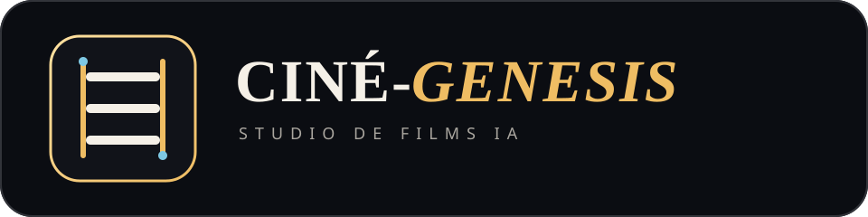

<div align="center">
  
  <p>
    
    
    
    
  </p>
  <p><strong>Esperanto</strong> · <a href="./README.fr.md">Français</a> · <a href="./README.en.md">English</a> · <a href="./README.es.md">Español</a></p>
</div>

# CINÉ-GENESIS

Memstara retaplikaĵo por krei mallongajn filmojn per artefarita inteligenteco.
Ĝi gvidas la tutan laborfluon, de la unua ideo ĝis bildoj kaj videoplanoj.

## Ĉefaj kapabloj

| Kapablo | Priskribo |
|---|---|
| Gvidata kreado | Sep klaraj paŝoj de ĝenro kaj sinoptiko ĝis la fina filmo |
| Kohera bildaro | Referencaj bildoj por roluloj, scenoj kaj ĉiu plano |
| Videogenerado | Vico de mallongaj filmetoj kun aŭtomata progreskontrolo |
| Daŭra laboro | Aŭtomata loka konservado kaj rekomenco post interrompo |
| Multoblaj ŝlosiloj | Distribuo de petoj inter pluraj API-ŝlosiloj |
| Privata defaŭlto | Ŝlosiloj restas en la langeto, krom se oni eksplicite konservas ilin |
| Portebla projekto | Eksporto al JSON sen API-ŝlosiloj |

## Bezonata API

CINÉ-GENESIS uzas ekskluzive la API de [Agnès AI](https://agnes-ai.com/).
Ŝlosiloj de OpenAI, Anthropic, Google Gemini aŭ aliaj provizantoj ne funkcias.

1. Malfermu la oficialan retejon de Agnès AI.
2. Elektu **Free API** aŭ **Access API**.
3. Kreu aŭ kopiu API-ŝlosilon en la programista spaco.
4. Algluu la ŝlosilon en la unuan ekranon de CINÉ-GENESIS.

La servoplanoj, kvotoj, prezoj kaj modelnomoj povas ŝanĝiĝi. Kontrolu la
aktualajn kondiĉojn ĉe Agnès antaŭ granda generado.

## Rapida komenco

Unu komando klonas la projekton kaj lanĉas lokan retservilon:

```bash
git clone https://github.com/AnARCHIS12/Voanh-Agnes-film-maker.git && cd Voanh-Agnes-film-maker && python3 -m http.server 8080
```

Poste malfermu `http://localhost:8080` en moderna retumilo.

## Laborfluo

1. **Konekto** — enigu la Agnès-ŝlosilojn kaj elektu la servoplanon.
2. **Formato** — elektu ĝenron kaj bildformaton.
3. **Sinoptiko** — verku tekston aŭ petu plibonigon de la AI.
4. **Roluloj** — kreu priskribojn, kostumojn kaj referencajn portretojn.
5. **Scenoj** — difinu mediojn, etosojn, dialogojn kaj ĉefajn bildojn.
6. **Planojn** — produktu la filmaran disdividon kaj komencajn bildojn.
7. **Videojn** — generu, kontrolu kaj ludu la kompletan sekvencon.

Ĉiu rezulto restas redaktebla antaŭ la sekva paŝo.

## Teknika agordo

| Uzo | Valoro |
|---|---|
| Baza API | `https://apihub.agnes-ai.com/v1` |
| Kontrolo de video | `https://apihub.agnes-ai.com/agnesapi` |
| Aŭtentikigo | `Authorization: Bearer VIA_ŜLOSILO` |
| Teksto | `agnes-3.0-flash`, poste `agnes-2.5-flash` |
| Bildo | `agnes-image-2.5-flash` |
| Senpaga video | `agnes-video-v2.0` |
| Token Plan-video | `agnes-video-2.5-flash` |

La aplikaĵo vokas `POST /v1/chat/completions`,
`POST /v1/images/generations`, `POST /v1/videos` kaj
`GET /agnesapi?video_id=...&model_name=...`.

## Arkitekturo

La projekto ne havas propran servilan fonon. La interfaco, stiloj kaj logiko
estas en `index.html`. Projektoj estas konservataj en `IndexedDB`, kun
`localStorage` kiel rezerva mekanismo.

```text
Projekto
├── agordoj, ĝenro kaj sinoptiko
├── roluloj
│   └── priskribo kaj referenca bildo
└── scenoj
    ├── medio, etoso, dialogoj kaj bildo
    └── planoj
        └── ago, kamerao, repliko, bildo kaj video
```

```text
.
├── assets/
│   ├── badges/          Lokaj SVG-insignoj
│   └── logo.svg         Oficiala projekta emblemo
├── index.html           Kompleta retaplikaĵo
├── LICENSE              AGPL-3.0-or-later
├── README.md            Esperanto
├── README.fr.md         Franca
├── README.en.md         Angla
└── README.es.md         Hispana
```

## Privateco kaj sekureco

La projektoj restas en la retumilo, sed AI-generado ne estas loka. La bezonataj
tekstoj, dialogoj, priskriboj, referencaj bildoj kaj konfirmitaj fotoj estas
sendataj al Agnès AI. Generitaj videoj povas resti atingeblaj per fora URL.

- API-ŝlosiloj restas nur en la nuna langeto defaŭlte.
- Loka memorigo estas nedeviga kaj povas esti forigita en la interfaco.
- Ŝlosiloj estas forigitaj el JSON-eksportoj.
- La aplikaĵo rifuzas neĉifritajn aŭ evidente lokajn amaskomunikilajn URL-ojn.
- Enhavsekureca politiko limigas la kapablojn de la paĝo.

Ne sendu personajn datumojn, konfidencajn verkojn aŭ bildojn de aliaj homoj sen
taŭga rajto kaj informita konsento.

## Kongrueco

| Medio | Subteno | Notoj |
|---|---|---|
| Chromium-bazitaj retumiloj | Plena | Rekomendita por video kaj voĉsintezo |
| Firefox | Plena | La disponeblaj voĉoj dependas de la sistemo |
| Safari | Moderna versio | Kontrolu aŭtomatan reproduktadon de video |
| Poŝtelefonaj retumiloj | Respondema interfaco | Longa generado postulas malfermitan langeton |
| Senreta uzo | Parta | Projektredaktado funkcias; AI-generado bezonas la Agnès-API |

## Kontribuado

1. Forku la deponejon kaj kreu celitan branĉon.
2. Konservu la projekton sen eksteraj CDN-oj, telemetrio aŭ sekretoj.
3. Ne aldonu emoji-signojn al la interfaco, dokumentado aŭ commit-mesaĝoj.
4. Kontrolu la JavaScript-sintakson kaj la respondeman interfacon.
5. Uzu konvencian commit-mesaĝon, ekzemple `fix: protect exported API keys`.
6. Malfermu kunfandopeton kun klara priskribo kaj kontrolrezultoj.

## Permesilo

La projekto estas libera programaro distribuata laŭ
[GNU Affero General Public License v3.0 aŭ posta](./LICENSE). Se modifita versio
estas disponebla per reto, ĝia responda fontkodo devas ankaŭ esti proponata laŭ
la kondiĉoj de la permesilo.
